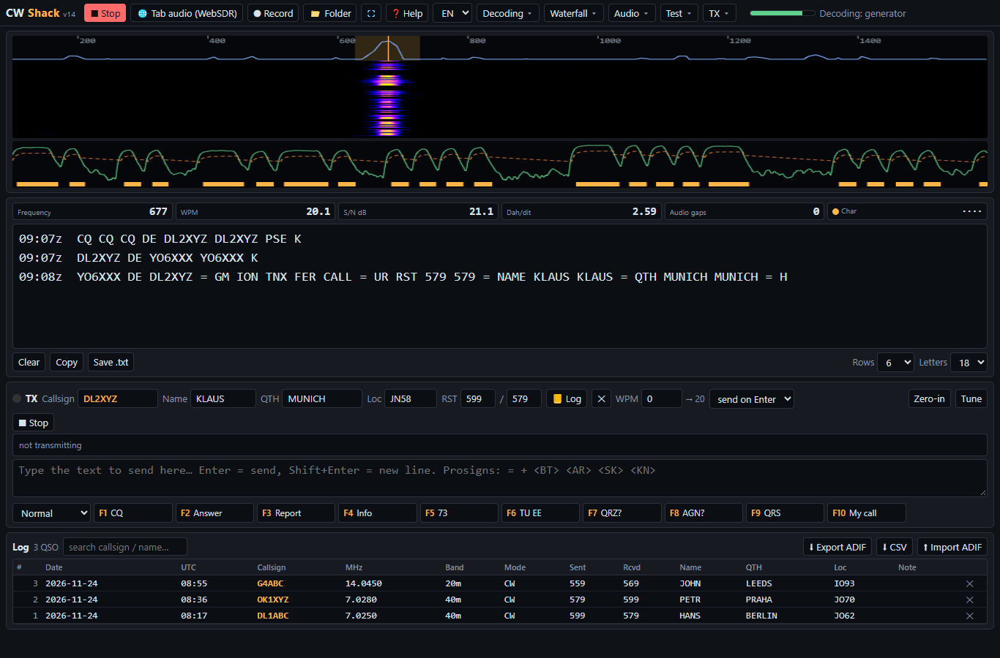

# CW Shack

**A complete CW (Morse) QSO station in your browser** — decoder, keyer with macros, CAT rig control, callsign lookup and logbook in a single web page. No installation, no server.

*Română mai jos ↓*

## Features

- **Adaptive CW decoder**
  - Learns each operator's speed, dah/dit ratio and spacing, including Farnsworth spacing and hand keying.
  - Copes with fading, QRN and noise: spectral squelch, peak hold, and removal of weak edge elements.
  - Re-decodes the current line in hindsight and corrects words with a dictionary (`UR5NN5NNBK` → `UR 5NN 5NN BK`).
  - Starts a new line when another station starts transmitting. It recognises the other station by tone, speed and keying style.
- **Sources**
  - Your rig through the sound card.
  - Any WebSDR / KiwiSDR tab.
  - Audio files.
  - A built-in test generator with noise, fading, QRM and QRN.
- **Transmit**
  - Keyer with typed text, prosigns, and F1–F10 macros in three sets: Normal, Short QSO, Contest (with serial numbers).
  - Automatic speed: sends at the correspondent's measured speed.
  - Keying by serial DTR/RTS, through the rig's own keyer over CAT (Yaesu), or as an audio tone.
- **CAT** (Yaesu FT-991A and similar)
  - Shows the frequency and mode.
  - Keeps the rig in CW-U / CW-L.
  - Zero-in.
- **Callsign lookup** on QRZ.com or HamQTH (name, QTH, locator, local time for GM/GA/GE). Shows whether you have worked the station before.
- **Logbook**
  - Kept in the browser and editable.
  - ADIF export and import, CSV export.
  - Automatic backup to your chosen folder.
- **Waterfall** with click-to-tune, signal envelope view, DSP listening filters, and recordings (.wav + decoded text).
- **Interface in English and Romanian**, with a built-in manual (❓ Help).

## Getting started

1. **Use it online**: open `https://<your-github-user>.github.io/cw-shack/` in **Chrome** or **Edge**.
   **Or download it**: get `index.html` from the [Releases](../../releases) page and double-click it.
2. Choose the audio input (Audio menu) and press **▶ Start**. Click a signal in the waterfall.
3. In the **TX** menu enter your callsign and station data. Connect the keying port and/or CAT.
4. Read the manual (❓ Help) for the details, including FT-991A setup (menu 060 PC KEYING = DTR, CAT RATE).

**Requirements:** a desktop Chromium browser (Chrome, Edge). Serial ports (Web Serial), tab audio capture and the working folder are not available in Firefox or Safari.

**Privacy:** settings, log and QRZ/HamQTH passwords stay in your browser, on your computer. The app connects only to QRZ.com / HamQTH (callsign lookup, with your account) and Open-Meteo (weather for `{WX}`, from your locator).

⚠ Test transmitting into a dummy load or at low power first.

## License

Copyright © 2026 **YO6UI**.

Free software under the **GNU General Public License v3** (see [LICENSE](LICENSE)).
- You may use, study, modify and redistribute it.
- Any redistributed version, modified or not, must stay under GPL-3.0 with its source code available.
- It must keep the original author attribution, *“CW Shack — © YO6UI”*. This is an additional term under GPL-3.0 section 7(b).

Bug reports, ideas and recordings of signals that decode badly are welcome in [Issues](../../issues).

---

# CW Shack (română)

**Stație CW completă în browser**: decodor, keyer cu macrouri, CAT, căutare indicativ și log, toate într-o singură pagină web. Fără instalare.

## Ce face

- **Decodor CW care se adaptează singur**
  - Învață viteza, raportul linie/punct și pauzele fiecărui operator, inclusiv spațierea Farnsworth și manipularea de mână.
  - Rezistă la fading, QRN și zgomot.
  - Redecodează rândul cu ce a învățat între timp și corectează cuvintele cu dicționarul.
  - Trece pe rând nou când emite altă stație.
- **Surse:** stația, prin placa de sunet; WebSDR / KiwiSDR, prin sunetul tabului; fișiere audio; generator de test.
- **Emisie**
  - Text și prosemne, macrouri F1–F10 în trei seturi: Normal, QSO scurt, Concurs (cu număr de concurs).
  - Viteză automată, după viteza corespondentului.
  - Manipulare pe DTR/RTS, prin keyer-ul stației (CAT Yaesu) sau ca ton audio.
- **CAT** (Yaesu FT-991A și altele): frecvența și modul, ține stația pe CW-U/CW-L, Zero-in.
- **Căutare indicativ** pe QRZ.com sau HamQTH, cu „lucrat înainte”.
- **Log** cu editare, export/import ADIF, export CSV și copie automată în folderul ales.
- **Interfață în română și engleză**, cu manual integrat (❓ Ajutor).

## Cum începi

1. Deschide `https://<utilizator-github>.github.io/cw-shack/` în **Chrome** sau **Edge**. Sau descarcă `index.html` de la [Releases](../../releases) și deschide-l cu dublu-click.
2. Alege intrarea audio (meniul Audio), apasă **▶ Pornește** și dă click pe semnal în waterfall.
3. Din meniul **TX** completează datele stației tale și conectează portul de manipulare și/sau CAT-ul.
4. Detaliile, inclusiv setarea FT-991A, sunt în manual (❓ Ajutor).

**Confidențialitate:** setările, logul și parolele rămân doar în browserul tău. Aplicația se conectează doar la QRZ.com / HamQTH și la Open-Meteo.

⚠ Testează emisia întâi pe sarcină artificială sau cu putere mică.

## Licență

© 2026 **YO6UI**. Program liber, sub licența **GNU GPL v3**.
- Îl poți folosi, modifica și redistribui.
- Orice versiune redistribuită trebuie să rămână sub GPL-3.0, cu sursa disponibilă.
- Trebuie să păstreze mențiunea autorului original, *„CW Shack — © YO6UI”*.

73 de YO6UI
